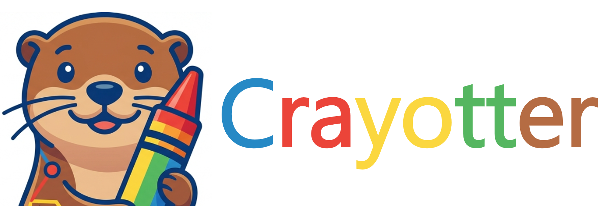
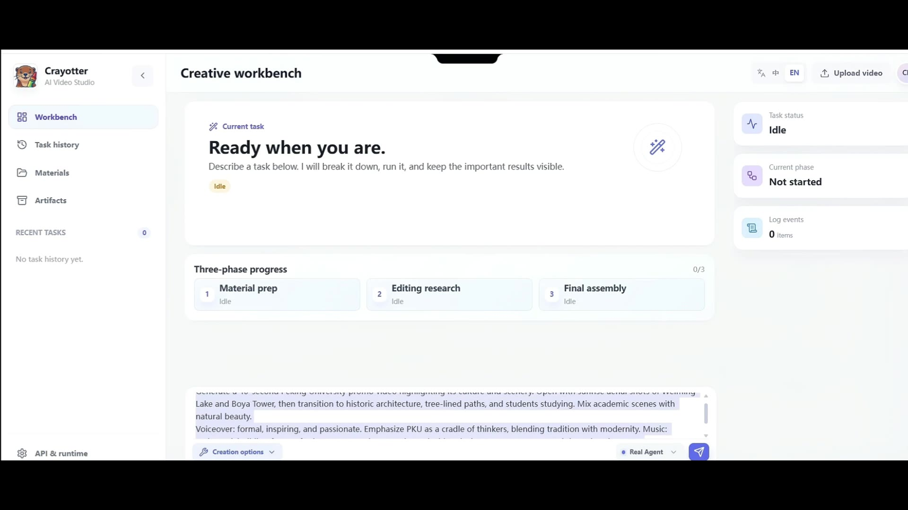
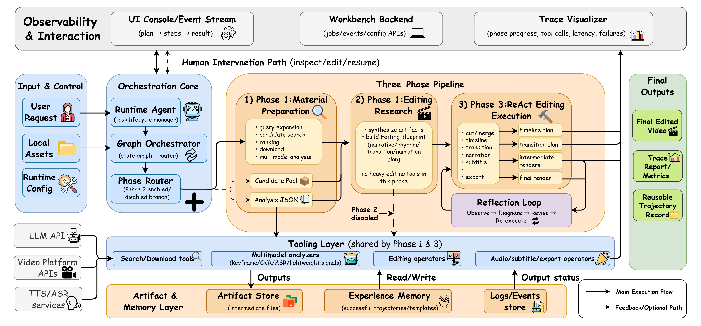

# Crayotter

<p align="center">
  <a href="./README.md">English</a> | <a href="./README_CN.md">中文</a>
</p>

<p align="center">
  
</p>

<p align="center">
  <a href="https://idwts.github.io/Crayotter" target="_blank" rel="noopener noreferrer">
    
  </a>
  <a href="https://github.com/idwts/Crayotter/stargazers" target="_blank" rel="noopener noreferrer">
    
  </a>
  <a href="https://idwts.github.io/Crayotter/paper/" target="_blank" rel="noopener noreferrer">
    
  </a>
  <a href="https://arxiv.org/abs/2606.07636" target="_blank" rel="noopener noreferrer">
    
  </a>
  <a href="https://arxiv.org/abs/2608.02694" target="_blank" rel="noopener noreferrer">
    
  </a>
  <a href="./LICENSE" target="_blank" rel="noopener noreferrer">
    
  </a>
</p>

<p align="center">
  If Crayotter helps your research or demos, please consider giving the repo a Star on GitHub.
</p>

Crayotter is a multimodal, agent-driven video editing system that turns a single text request into a complete edited video. It combines **planning**, **deep editing research**, and **tool-based execution** into a three-phase workflow, with full logs and visual trace analysis for debugging and iteration.

---

## 📽️ Demo

<p align="center">
  <a href="https://idwts.github.io/Crayotter/#demo">
    
  </a>
</p>

<p align="center">
  <a href="https://idwts.github.io/Crayotter/#demo">Watch the operation demo online</a>
</p>

A full end-to-end run: from a one-line text request, Crayotter prepares materials, researches an editing blueprint, and produces the final edited video. The online player also includes three finished case videos.

---

## Table of Contents

- [Demo](#️-demo)
- [News](#news)
- [Highlights](#highlights)
- [Overview](#overview)
- [Workflow](#workflow)
- [Quick Start](#quick-start)
  - [Install and open](#install-and-open)
  - [Your first video](#your-first-video)
- [Common questions](#common-questions)
- [Run from source](#run-from-source)
- [Development and research](#development-and-research)
- [Citation](#citation)
- [Repository Layout](#repository-layout)

---

## News

- **2026.9.16** — Our [paper](https://arxiv.org/abs/2606.07636) is accepted by AACL-IJCNLP 2026 Demo Track!
- **2026.8.5** — Our new work is now available! Towards long-horizon video editing agents: [Crayotter: Learning Long-Horizon Video Editing Agents via Group-Relative Preference Backpropagation](https://arxiv.org/abs/2608.02694)。
- **2026.6.27** — Crayotter 1.0.0 adds multi-source material import, unified download cleanup, and refreshed Windows release packaging.
- **2026.6.15** — Asynchronous scheduling upgrade accelerated the overall video generation workflow by ~1.6×.
- **2026.5.31** — Our paper is now available: [Crayotter: Traceable Multi-Agent Workflows for Long-Form Video Editing](https://arxiv.org/abs/2606.07636).
- **2026.5.23** — 100 Stars achieved!
- **2026.5.11** — The paper page is now live at [Crayotter Paper Page](https://idwts.github.io/Crayotter/paper/).
- **2026.4.10** — The release has been updated.
- **2026.3.30** — First release version available. See [v0.1.0-demo](https://github.com/idwts/Crayotter/releases/tag/v0.1.0-demo).

---

## Highlights

- **One request to one video** — A single natural-language prompt drives the whole pipeline from sourcing to export.
- **Three-phase, traceable workflow** — Explicit planning, pure-reasoning editing research, and controlled tool execution, all logged for replay.
- **Multimodal material understanding** — Each source video is analyzed by a multimodal model to inform narrative and pacing.
- **Resource-aware DAG scheduling** — Bounded concurrency for search, download, analysis, LLM, FFmpeg, TTS, and export, with retries, conflict keys, and checkpoint/resume.
- **Multi-source material import** — Bilibili, Douyin, Xiaohongshu/Rednote, Kuaishou, YouTube, or generic URLs (via `yt-dlp`).
- **Built-in narration, subtitles, and audio mixing** — Segmented TTS, loudness normalization, background-ducking, and subtitle burn-in.
- **Local workbench + desktop mode** — Web UI for task management, `.env`-synced config, structured logs, artifact preview, and interrupted-job resume.
- **Visual trace analysis** — Local server + static HTML export for inspecting phase progress and tool-call trajectories.

---

## Overview

<p align="center">
  
</p>

This repository centers around four core components:

- **`script/agent.py`** — Main entrypoint. Initializes runtime, runs tasks (interactive or single request), performs workspace cleanup, and writes logs/experience memory.
- **`script/graph.py`** — Orchestration layer (LangGraph `StateGraph`). Defines the three-phase workflow and routing.
- **`script/tools/`** — Modular toolset for search, download, analysis, cutting, transitions, narration, subtitles, and export.
- **`script/visualize.py`** — Log parser + local trace server for inspecting phase progress and tool calls.

Supporting folders:

- **`temp/`** — Intermediate and output artifacts during execution.
- **`user_temp/`** — User-provided local source assets.
- **`logs/`** — Runtime logs (`video_agent_*.log`).
- **`memory_experience/`** — Concise historical-case notes kept for reference only; they must not override the current task goal.
- **`website/`** — Static launch site and GitHub Pages assets.

---

## Workflow

Crayotter uses a three-phase architecture:

```text
START -> planner -> phase1_scheduler -> material_gap_evaluator
material_gap_evaluator -> planner (supplement) | editing_research | react_editor
editing_research -> react_editor -> END
```

1. **Phase 1 — Material Preparation (Planner + Executor)**
   - Planner emits an explicit dependency DAG.
   - A deterministic scheduler validates dependencies, resource pools, retries, and write conflicts.
   - Search, per-video download, and per-video analysis tasks execute concurrently when resources are available.
   - A Material Gap Evaluator decides whether to proceed or run an incremental sourcing round (at most two supplement rounds, reusing already-successful tasks).
   - Search candidate videos through the platform-agnostic material-source layer.
   - Import user-provided URLs from Bilibili, Douyin, Xiaohongshu/Rednote, Kuaishou, YouTube, or generic URLs when supported by `yt-dlp`.
   - Rank/select high-quality candidates (target orientation is a scoring factor: landscape by default, portrait when requested).
   - Download selected videos and standardize them into editing-compatible MP4/H.264/AAC assets.
   - Analyze each source video multimodally.

2. **Phase 2 — Editing Research**
   - Research source analyses concurrently.
   - Build narrative, visual, pacing, and narration strategies concurrently.
   - Integrate them into one structured editing blueprint (JSON + compatibility Markdown).
   - No editing tools are called in this phase — it is pure reasoning.

   This phase can be disabled with `CRAYOTTER_ENABLE_PHASE2_RESEARCH=false` in the runtime `.env` to save tokens. When disabled, the workflow becomes: Phase 1 → Phase 3.

3. **Phase 3 — ReAct Editing Execution**
   - Prefer a controlled editing DAG with parallel clip cutting and segmented TTS.
   - Keep timeline merge, mixing, subtitles, quality evaluation, and export serial.
   - Fall back to the existing ReAct editor when structured planning or validation fails.
   - Log full tool-call trajectory for later trace visualization.

---

## Quick Start

### Install and open

| Platform | Where to get it | How to open |
| --- | --- | --- |
| Windows 10/11 x64 | `Crayotter-Windows-x64.zip` in [Releases](https://github.com/idwts/Crayotter/releases) | Extract the complete archive and run `Crayotter.exe` |
| macOS Apple Silicon | Test builds in [Actions](https://github.com/idwts/Crayotter/actions/workflows/desktop-build.yml); check Releases for published packages | Unzip and open `Crayotter.app`, or move it to Applications |

Desktop packages include Python, FFmpeg, and the downloader. Conda is not required. The Windows native window uses Edge WebView2; browser mode is attempted if unavailable. The current Mac package declares macOS 15.0 or newer and targets arm64; test packages are not Apple-notarized.

### Your first video

1. **Set up models:** open Settings and enter your API key, endpoint, and models. Provider charges apply; Crayotter does not include API credit.
2. **Choose material:** upload local videos, describe a subject for online sourcing, or provide video links.
3. **Describe the edit:** include duration, style, orientation, narration, and subtitle preferences, then start the task.
4. **Review the result:** preview and save the final video from the task details, checking the narration, subtitles, and footage.

Defaults are `qwen3.8-flash` for planning/editing, `qwen3.8-omni-flash` for audio/video analysis, and `qwen3-tts-flash` for speech. For visual-only analysis, set the video model to `qwen3.8-flash`. Explicit model settings are preserved.

Sourcing, video analysis, and model reasoning take time. Runtime depends on footage length and provider response. A 30-second task is a useful first run.

## Common questions

**Where is the result?**
Open the task details in the workbench. Mac runtime data defaults to `~/Library/Application Support/Crayotter`; Windows uses the writable program directory or the user application-data directory.

**Why did sourcing fail?**
Check platform access. For platforms requiring login, authorize through your local browser and retry, or upload your own footage.

**Why did the model or narration fail?**
Check the API key, endpoint, model availability, and account balance. Text, video, and speech providers can be configured separately.

**Can I resume?**
The workbench can resume jobs marked interrupted. A failed job is different and is not guaranteed to resume in place.

## Run from source

Use Python 3.10+ and FFmpeg/FFprobe. Runtime paths select matching bundled tools when available; on Mac, `python script/setup_ffmpeg.py` can fetch missing binaries.

```bash
python -m pip install -r requirements.txt
python script/run_backend.py --host 127.0.0.1 --port 8765
```

Open `http://127.0.0.1:8765/ui/` and configure your API in Settings. For a native window, also install `requirements-desktop.txt` and run `python script/run_desktop.py`.

## Development and research

- [Source setup, configuration, and traces](docs/development.md)
- [Architecture](docs/architecture_cn.md)
- [Tool protocol, MCP, and FFmpeg](docs/tool_protocol_and_ffmpeg.md)
- [Windows build](packaging/build_windows.ps1) / [macOS build and signing](packaging/README_MACOS_CN.md)
- [Papers and citation](docs/citation.md); [experimental RL training](phase3_rl/README.md) is separate from everyday editing.

---

## Citation

If you find Crayotter useful for your research or work, please cite:

```bibtex
@misc{yan2026crayottertraceablemultiagentworkflows,
      title={Crayotter: Traceable Multi-Agent Workflows for Long-Form Video Editing}, 
      author={Lecheng Yan and Yichong Zhang and Xiantao Xu and Jianze Lin and Ben Pan and Xiaoyu Zheng and Jiawei Qian and Anqi Wu and Jiahui Geng and Ruizhe Li and Fengyu Cai and Jingcheng Niu and Raymond Li and Wenxi Li and Chenyang Lyu},
      year={2026},
      eprint={2606.07636},
      archivePrefix={arXiv},
      primaryClass={cs.CV},
      url={https://arxiv.org/abs/2606.07636}, 
}

@misc{yan2026crayotterlearninglonghorizonvideo,
      title={Crayotter: Learning Long-Horizon Video Editing Agents via Group-Relative Preference Backpropagation}, 
      author={Lecheng Yan and Jianze Lin and Yichong Zhang and Ben Pan and Wenxi Li and Chenyang Lyu and Liting Zhou and Cathal Gurrin},
      year={2026},
      eprint={2608.02694},
      archivePrefix={arXiv},
      primaryClass={cs.CL},
      url={https://arxiv.org/abs/2608.02694}, 
}
```

---

## Repository Layout

```text
Crayotter/
├─ script/
│  ├─ agent.py
│  ├─ graph.py
│  ├─ visualize.py
│  └─ tools/
├─ app/                # backend server, frontend, runtime paths
├─ packaging/          # Windows / macOS release build scripts
├─ phase3_rl/          # experimental RL smoke pipeline (not the main runtime)
├─ demo/               # showcase media
├─ logs/
├─ temp/
├─ user_temp/
├─ memory_experience/
├─ website/            # static site + GitHub Pages assets
├─ logo.png
├─ crayottor_framework.jpg
└─ requirements.txt
```

Licensed under [PolyForm Noncommercial 1.0.0](LICENSE). Check the terms before commercial use.
